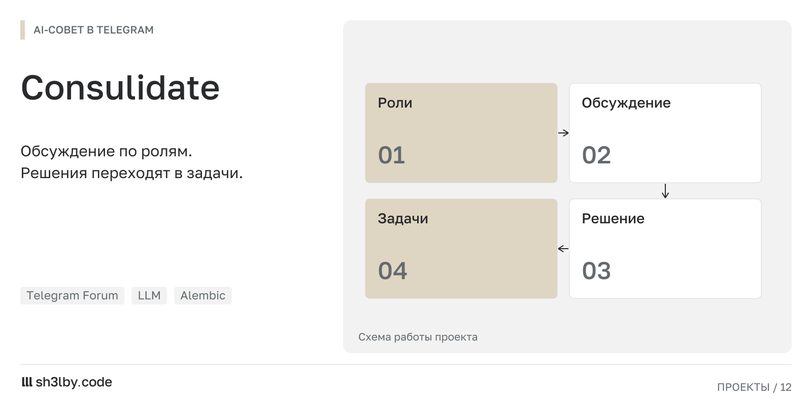

# Consulidate

<!-- portfolio-card:start -->
[](docs/portfolio/card.svg)
<!-- portfolio-card:end -->

Довести обсуждение проекта до зафиксированного решения и задачи. Consulidate работает внутри Telegram-форума: бот собирает позиции виртуальных руководителей, сохраняет аргументы и возвращает просроченные вопросы в повестку.

Пользователь описывает инициативу. Роли обсуждают её с разных сторон, задают вопросы и пересматривают позиции. Если данных недостаточно, обсуждение ждёт ответа владельца. После решения создаётся задача с ответственным и сроком пересмотра.

## Что остаётся после обсуждения

Инициатива связана с сообщениями, Evidence, публичными позициями, решением и задачей в PostgreSQL. Стадия дебатов сохраняется после каждого раунда и восстанавливается после перезапуска. Часовой цикл проверяет повестку; пустые циклы не засоряют чат.

Это MVP системы обсуждения и учёта решений. Вопросы за пределами настроенного уровня L0/L1 передаются владельцу. У агентов нет SSH, shell, Docker, доступа к production-БД, Vault, развёртыванию, финансовым операциям или произвольным инструментам. Результат их работы во внешнем мире ограничен записью Task и сообщением человеку.

Обсудить похожий проект: [sh3l.beer](https://sh3l.beer).

## Архитектура

```text
Telegram forum / aiogram
          │
          ▼
CouncilService ─── PostgreSQL / SQLAlchemy / Alembic
          │
          ├── Debate: PROPOSE → QUESTION → CHALLENGE → DEFEND → REVISE → DECIDE
          ├── HourlyCycle: OBSERVE → SELECT → DISCUSS → DECIDE → ASSIGN → MONITOR
          └── AtlantAdapter → AurethosSDK.APIRouter → Codex Gateway
                    └── FakeAtlantAdapter (только dev/test)
```

`AurethosSDK` — фактическое legacy-имя SDK в этом репозитории. Consulidate не создаёт параллельный model router:
реальный адаптер собирает `Model`, `BaseModel`, `APIRouter` и вызывает `send_api_request()`. JSON SDK дополнительно
проверяется Pydantic v2; невалидный ответ повторяется не более двух раз. Синхронный SDK запускается через
`asyncio.to_thread`, поэтому Telegram event loop не блокируется.

Долговременная память — связанные Organization, Project, Issue, человеческие сообщения, Evidence, публичные
AgentPosition, Decision и Task. Embeddings в поставленном SDK нет, поэтому MVP использует детерминированную
нормализацию и token similarity для дублей.

Общий проектный контекст читается перед каждым модельным вызовом из `project_context/*.md` в алфавитном порядке.
Изменения файлов видны без перезапуска; общий объём ограничен `project_context.max_characters` в YAML. Каталог
монтируется в app-контейнер read-only. Не кладите туда секреты, инструкции агентам и непроверенные production-данные.

## Требования

- Python 3.12+;
- PostgreSQL 16+;
- Telegram bot от `@BotFather`;
- supergroup с включённым Topics/Forum;
- для реальных моделей — доступный Codex Gateway и bearer token.

## Быстрый локальный запуск

```bash
cp .env.example .env
python3 -m venv .venv
.venv/bin/pip install -e '.[test]'
docker compose up -d postgres
.venv/bin/alembic upgrade head
.venv/bin/python -m consulidate --check
.venv/bin/python -m consulidate
```

В этой среде установлен старый Compose, поэтому эквивалентная команда — `docker-compose up -d postgres`.
Приложение намеренно не запускает миграции автоматически.
Compose публикует PostgreSQL на `localhost:55433`; порт можно изменить через `POSTGRES_PORT` и `DATABASE_URL`.

Перед обычным запуском заполните `TELEGRAM_BOT_TOKEN` в `.env` и хотя бы один Telegram ID владельца в
`config/consulidate.yaml`:

```yaml
telegram:
  owner_ids: [123456789]
  chat_id: null
  topics: {}
```

`CONSULIDATE_MODEL_PROVIDER=fake` позволяет локально пройти весь flow без платных вызовов. Это детерминированный
dev-провайдер, а не production-модель.

## Telegram forum

1. Создайте группу, преобразуйте её в supergroup и включите Topics.
2. Добавьте бота администратором с правом управлять topics и отправлять сообщения.
3. Узнайте свой numeric owner ID (например, через служебного ID-бота) и внесите его в YAML.
4. Добавьте бота в группу и вызовите `/setup`. При `chat_id: null` текущая группа станет рабочей.
5. `/setup` проверит `is_forum`, создаст отсутствующие топики и сохранит их numeric IDs в PostgreSQL.

Если нужные topics уже созданы человеком, сначала внутри каждого вызовите `/setup bind <topic-key>`, а после
привязки всех существующих — обычный `/setup`. Ключи:

| key | topic |
|---|---|
| `cabinet` | 🏛 Кабинет |
| `initiatives` | 📥 Инициативы |
| `portfolio` | 📊 Портфель проектов |
| `risks` | 🚨 Риски и инциденты |
| `growth` | 📈 Рост и сообщество |
| `technical` | ⚙️ Технический комитет |
| `reports` | 🧾 Отчёты лидеров |
| `decisions` | 📜 Реестр решений |
| `archive` | 🗄 Архив |

Numeric IDs также можно задать в `telegram.topics` YAML. Сохранённая в БД привязка имеет приоритет;
`/setup bind` используется для явного переназначения.

## AtlantSDK / Codex Gateway

Для реального совета:

```dotenv
CONSULIDATE_MODEL_PROVIDER=atlant
CODEX_GATEWAY_URL=http://127.0.0.1:8765
CODEX_GATEWAY_TOKEN=replace-me
CODEX_GATEWAY_MODEL=gpt-5.4
CODEX_GATEWAY_WORKSPACE=/path/inside/CODEX_API_ALLOWED_ROOT/consulidate-model-workspace
CODEX_GATEWAY_SANDBOX=read-only
```

В Docker на Linux app использует host network, чтобы обращаться к gateway, который безопасно слушает только
`127.0.0.1`; PostgreSQL остаётся опубликован на `POSTGRES_PORT` (по умолчанию `55433`).
`CODEX_GATEWAY_WORKSPACE` должен существовать внутри `allowed_root` из `GET /health`; используйте отдельный пустой
каталог без `.env`, исходников и секретов.

Consulidate передаёт только карточку Issue, ограниченную релевантную память, Evidence и публичные позиции. Токены,
`.env`, скрытые рассуждения и prompts других ролей в контекст не попадают. Gateway должен поддерживать
`/models/list`, `/sessions` и `/chat` из текущего AurethosSDK.

## Команды

Инициативу можно указать reply к любой связанной карточке/позиции/решению/задаче либо первым аргументом `MJ-001`.

| Команда | Назначение | Право |
|---|---|---|
| `/setup`, `/setup bind risks` | создать/привязать topics | Owner |
| `/new <описание>` | создать инициативу; поддерживает reply | участник |
| `/discuss [MJ-001]` | полные дебаты | Owner |
| `/summon [MJ-001] cto cfo risk` | дебаты с 3–5 указанными ролями | Owner |
| `/status [MJ-001]` | краткий статус | участник |
| `/decide [MJ-001]` | завершить текущие дебаты решением | Owner |
| `/approve`, `/reject`, `/veto` | изменить последнее решение | Owner |
| `/assign [MJ-001] <telegram-id> <YYYY-MM-DD\|none> [текст]` | назначить задачу | Owner |
| `/report [MJ-001] <текст>` | сохранить Evidence | участник |
| `/block [MJ-001] <причина>` | зафиксировать блокер | Owner/Project Lead |
| `/review [MJ-001]` | принудительный пересмотр | Owner |
| `/reopen`, `/archive` | переоткрыть/архивировать | Owner |
| `/cycle` | ручной идемпотентный hourly bucket | Owner |
| `/cycle force [MJ-001]` | новый цикл; с ID/reply принудительно обсуждает инициативу | Owner |
| `/help` | справка | все |

Обычное верхнеуровневое сообщение в «Инициативах» создаёт Issue. Ответ на позицию, например
`@CTO откуда оценка?`, связывается с Issue, классифицируется и передаётся именно CTO. Командой считается только
реальная Telegram command entity от `from_user`; процитированный текст прав не даёт.

## Пример цикла

1. Пользователь пишет в «Инициативах»: `Проверить новый онбординг`.
2. Бот публикует `📌 MJ-001`, рассчитывает приоритет по пяти факторам.
3. При `priority >= 0.65` Chief of Staff выбирает 3–5 ролей.
4. У позиции краткий вывод остаётся видимым, а все аргументы, риски, вопросы и условия публикуются внутри нативной
   сворачиваемой цитаты Telegram без обрезки. Если хотя бы одна роль возвращает `NEED_DATA`, Chief of Staff один раз
   задаёт владельцу объединённые вопросы и останавливает дебаты в `WAITING_FOR_OWNER`; ответ или `/report` добавляет
   контекст, а `/review` продолжает тот же debate.
5. После получения достаточных данных совет сохраняет противоречия, возражения и пересмотренные позиции.
6. Обратимый L1 с risk ≤ 0.30, reversibility ≥ 0.80, confidence ≥ 0.70 и допустимой стоимостью утверждается
   автоматически; L2/L3 ожидает `/approve` владельца.
7. Утверждение создаёт Task. Если ответственный неизвестен, Issue остаётся `WAITING_FOR_OWNER`.
8. В дату review или при просрочке задача возвращается в повестку.
9. «Кабинет» получает сводку только при значимых событиях; пустой цикл молчит.

Повторный Telegram update защищён receipt-таблицей. Один interval bucket создаётся один раз, позиции уникальны по
debate/role/round, решение — по debate ID, а Task — по Decision. Стадия и участники дебатов сохраняются после
каждого раунда и восстанавливаются после рестарта.

## Миграции и тесты

```bash
alembic current
alembic upgrade head
alembic downgrade base   # удаляет все данные; только для пустой локальной БД

python3 -m pytest -q
ruff check consulidate tests alembic
mypy consulidate
python3 -m compileall -q consulidate
```

Unit/integration-тесты используют временную SQLite, синтетические aiogram Update, FakeAtlantAdapter и
FakePublisher: настоящий Telegram и платные модели не вызываются. PostgreSQL-граница отдельно проверяется Alembic
migration smoke через Compose.

## Конфигурация цикла и автономности

Основные параметры находятся в `config/consulidate.yaml`: interval, максимум новых и повторных дебатов, 3–5
участников, максимум 3 раунда, число SDK-вызовов, приблизительный token budget, timeout и пороги L1. При
исчерпании бюджета состояние сохраняется, цикл получает `budget_exhausted`, а не падает.

## Ограничения MVP и развитие

- одна организация и один Telegram forum на один процесс, хотя схема изолирует данные по Organization;
- Research Director исследует только предоставленную память/Evidence, без web-доступа;
- token usage оценивается по длине текста, поскольку текущий gateway не возвращает usage;
- нет embeddings, web UI, внешних task trackers и автоматического исполнения решений;
- Project Lead назначается в БД; отдельная административная команда управления участниками не входит в MVP;
- baseline Alembic создаёт schema v1 из metadata; дальнейшие изменения должны быть отдельными явными revisions.

Следующие безопасные шаги: отдельные organization configs, SDK usage metadata/embeddings, административное
управление ProjectMember и read-only коннекторы Evidence с явным allowlist.
